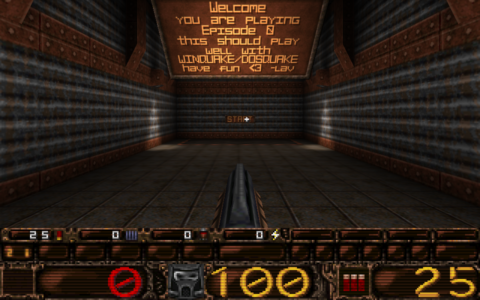
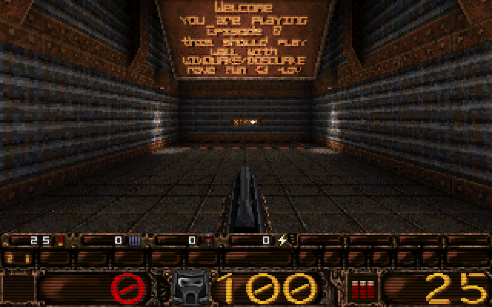

# Edict
Edict - a frame-exact C# port of the WinQuake engine source, zero allocations in the game loop

| GPU renderer (OpenGL 3.3, GLQuake's look; the default) | The exact software renderer (320×200, shown 3×) |
|---|---|
|  |  |

The software renderer's frame on the right is the one the gates compare with the C reference, pixel for pixel. Both
show [LibreQuake](https://github.com/lavenderdotpet/LibreQuake)'s free data (BSD-3-Clause,
[license](docs/images/LICENSE-LibreQuake.txt)).

## Quick start

Without anything installed: the [releases](https://github.com/AndreKfm/Edict/releases) have a package per system
(Windows x64, Linux x64) with the game as one self-contained program; unpack it and start `play.cmd` or
`./play.sh`, which fetch LibreQuake's free game data on the first start.

From the source, with the [.NET 10 SDK](https://dot.net) installed, one command fetches the game data (on the first
run), builds the game and starts it:

- Windows: double-click `play.cmd`, or `.\play.ps1` in PowerShell
- Linux: `./play.sh` (needs an X server; Wayland desktops have XWayland, WSLg works)

Arguments go to the game, e.g. `play.cmd -listen 4` for a listen server, `./play.sh +connect 192.168.1.5` to join
one, `+map lq_e0m1` for another map, `-software` for the exact software renderer. In the game, `` ` `` opens the
console and `quit` ends it (the menu is a stub, as in the reference). More under [Playing](#playing) and
[Multiplayer](#multiplayer).

## Status: a finished proof of concept

Edict set out to show that a C game engine can be ported to C# so that it computes exactly what the C program
computes, frame for frame, without allocating in its loop and without being slower. That is shown (2026-10-15);
the project is complete as a proof of concept and is not developed further. docs/PLAN.md has every phase with its
findings, docs/TESTING.md how each claim is tested.

What is shown, each by state hashes (XXH64) against a C reference build of WinQuake's GPL source release:

- **The server** — the QuakeC VM, the builtins, physics, the hull traces, several clients and their commands:
  every frame and spawn record of the corpus' input tapes (ten maps, 4,000 frames each; ten-minute runs of 43,199
  frames) and every message sent to every client, as the reference's.
- **The client** — demo playback and a listen server's local client: every client record.
- **The software renderer, the 2D layer and the console** — every present's 320×200 frame buffer and palette, over
  150,000 presents in the full-frame corpus alone.
- **The sound** — the mixer's DMA buffer after every frame (172,765 sound records).
- **The network's exact part** — the server with several clients and net_dgrm.c (a differential fuzz against the
  reference's own code).
- **No allocation** in the game loop, enforced per member by a Roslyn analyzer (`[NoAlloc]`) and measured at 0 bytes
  in every frame of the corpora but those that load (the spawn, a demo) or run a console command; **no slowdown**: the port runs the ten-minute run at 0.72 of the reference's time
  per frame.
- **Robustness of the gates** — mutation testing (`tools/mutate.py`; in the last phase 269 mutants, all detected but
  34 known blind spots, each with its reason), and the reference itself checked at -O0, -O2, under ASan/UBSan, on
  Windows and Linux (identical records).

It is also a playable game: a window on Windows and Linux, keyboard and mouse, Quake's sound, a GPU renderer, and
multiplayer over UDP, interoperating with the reference's own network build.

The limits of the claim:

- Exact means exact on the corpus: LibreQuake's free data, the runs and the synthetic inputs in docs/PLAN.md, not
  every map or mod there is.
- The reference is WinQuake with a pinned C library (sin, cos, tan, atan, atan2, rand, strcmp, sprintf and atof in
  `ref/src/edict_libc.c`, [D3](docs/adr/D3-pinned-libc.md)) and twelve minimal patches (`ref/patches`), not the binary
  of 1996.
- Outside the proof by design: the GPU renderer (it reads the exact state, never writes it) and the sockets.
- Not ported: the menu (the reference's is a stub), save and load, demo recording and the demo loop, screenshot,
  sizeup and sizedown, slist, CD audio, the debug commands.

How it was built: Edict was developed with AI. Claude Opus 5.5 (Anthropic), working as a coding agent in Claude
Code, wrote most of the code, the tools and the documentation, under a plan with hard, measurable gates and with
the owner's decisions at every step (docs/PLAN.md, docs/adr/); its commits say so ("Co-Authored-By: Claude Opus
5.5"). That is why the proof matters: nothing here has to be taken on trust, as every claim above is a test that
compares bits with the C original, and the mutation tests show that those tests catch the mistakes a translation
makes.

To check it yourself: `sh tools/fetch-data.sh`, build the reference (`ref/build.sh`), write the corpora with it (the
`tools/*.sh` generators in docs/TESTING.md, or `tools/ci-corpora.sh` for the fast ones) and run
`sh tools/test.sh full` with `EDICT_ORACLE` set; the CI (`.github/workflows/ci.yml`) does the fast part of this on
every pull request.

## Playing

The game needs a Quake game directory with an `id1` folder (for example LibreQuake's release). On Windows it opens
a Win32 window, on Linux an X11 one; no packages are involved.

```sh
dotnet build src/Edict.Platform -c Release
dotnet src/Edict.Platform/bin/Release/net10.0/edict.dll -basedir <game directory> +map start
```

The view is drawn by the GPU renderer (OpenGL 3.3 core, GLQuake's look) by default; `-software`, or `r_gpu 0` at
the console, shows the exact software renderer, the one the port is proven against. The arguments are Quake's
(`+map <name>`, `+skill 2`, ...); without a `+map` the game starts `start`. The console
(`` ` ``) takes the commands, the default bindings are the game directory's `default.cfg`. The menu is the one the
reference build uses, a stub: Escape does nothing, `quit` at the console ends the game. The sound is Quake's mixer,
ported as exactly as the renderer, played through waveOut on Windows and ALSA on Linux; `-nosound` turns it off.

The free game data the tests and the reference run on is LibreQuake's: `sh tools/fetch-data.sh` puts it in
`data/libreq-v0.09-beta`, which then serves as the game directory.

## Multiplayer

Quake's network over UDP (port 26000 by default). A listen server, where you play and others join:

```sh
dotnet src/Edict.Platform/bin/Release/net10.0/edict.dll -basedir <game directory> -listen 4 +map start
```

A dedicated server, without a window: its console reads stdin and prints to stdout (`quit` ends it):

```sh
dotnet src/Edict.Platform/bin/Release/net10.0/edict.dll -basedir <game directory> -dedicated 4 +map start
```

To join, `connect <address>` at the console or `+connect <address>` on the command line. As in WinQuake, Quake's
parser splits a command at a colon, so a port other than the default goes in quotes (`connect "192.168.1.5:26001"`)
or with `-port <n>`. `-port <n>` also sets the port a server listens on; `-nolan` leaves the network out.

## Tests

`sh tools/test.sh quick` (before a commit) and `sh tools/test.sh full`, with `EDICT_ORACLE` pointing to the oracle
library `ref/build.sh` builds from the C reference; docs/TESTING.md has the tiers, the corpora and the checks
around them.

## License and trademarks

Edict is licensed under the GNU General Public License, version 2 or later (`LICENSE`), as is the WinQuake source
release it ports (Copyright (C) 1996-1997 Id Software, Inc.); `THIRD-PARTY-NOTICES.md` lists everything it contains
or derives from that is not its own. It contains no game data: it needs LibreQuake's free data (`tools/fetch-data.sh`) or the user's
own copy of the game.

Quake is a registered trademark of id Software LLC. Edict is not affiliated with or endorsed by id Software,
ZeniMax Media or Microsoft; the name is used only to say which engine source Edict ports and which game data it
runs.
